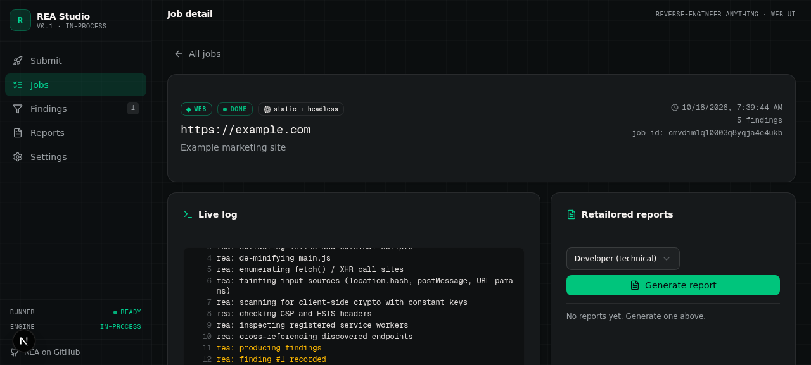
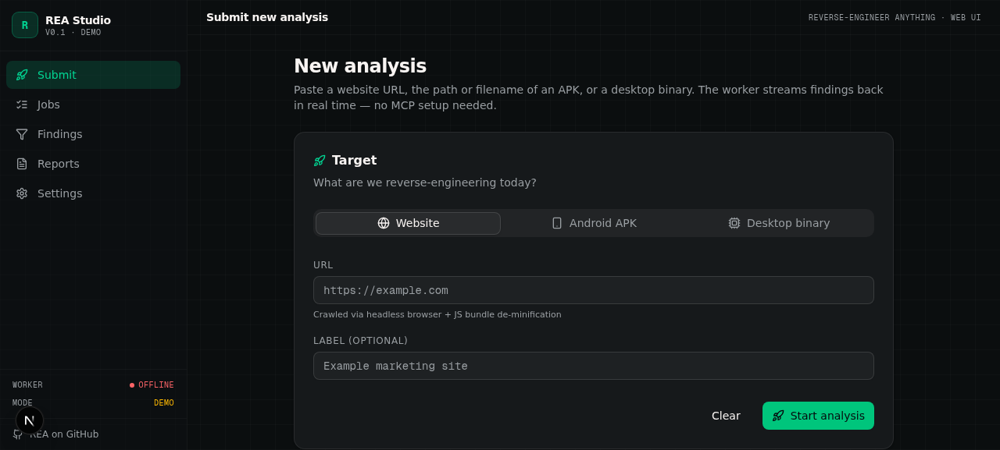
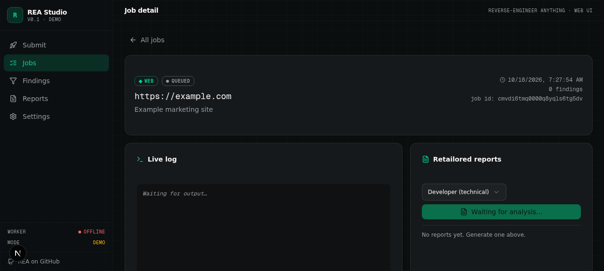
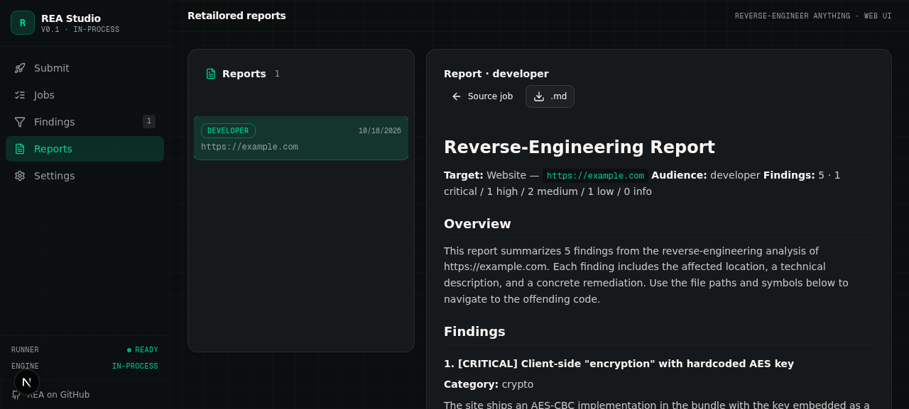
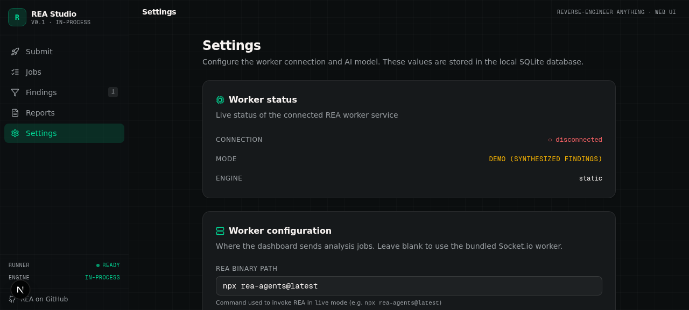
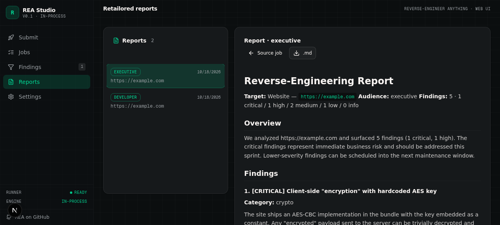
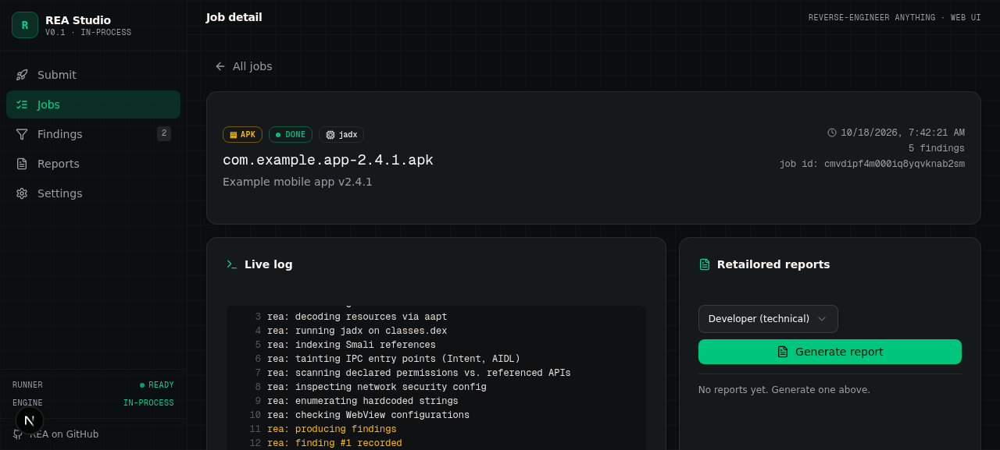

# REA Studio

A thin web UI on top of the [REA (Reverse Engineer Anything)](https://github.com/morluto/rea) MCP server. Paste a website URL, APK path, or binary path → watch findings stream in → generate audience-tailored reports (developer / executive / QA / auditor) → download as Markdown.



## Why this exists

REA is a powerful CLI + MCP server, but using it means: terminal, MCP config, manual file paths, raw tool output. REA Studio wraps all of that in a single-page dashboard you can deploy for free and access from a browser.

**Phase 1 status:** Website targets fully wired. APK / binary targets are scaffolded but disabled until you flip `enabled: true` in `src/lib/runner.ts` after installing JDK + JADX/Ghidra locally.

## Features

- **Submit** — website URL / APK filename / binary path (tab picker, validation per type)
- **Live job stream** — progress bar, streaming log viewer, cancel button
- **Findings** — severity (CRITICAL/HIGH/MEDIUM/LOW/INFO) + category (api/network/crypto/permission/behavior/string) filters, expandable evidence blocks
- **Retailored reports** — generate per-audience reports using `z-ai-web-dev-sdk` (developer / executive / QA / auditor), with deterministic fallback when no API key is configured. Download as Markdown.
- **Settings** — REA binary path, upload dir, demo mode, default audience, live worker status
- **Readiness check** — `/api/readiness` reports whether `rea` CLI is installed and which target types are enabled

## Tech stack

- **Framework:** Next.js 16 (App Router, TypeScript 5)
- **Styling:** Tailwind CSS 4 + shadcn/ui (New York)
- **Database:** Prisma ORM + SQLite (single-user, file-based)
- **State:** Zustand (client) + TanStack Query (server)
- **AI:** z-ai-web-dev-sdk for retailoring reports
- **Runner:** in-process `child_process.spawn` of the `rea-agents` CLI

## Quick start (local dev)

```bash
git clone https://github.com/YOUR_USERNAME/rea-studio.git
cd rea-studio
bun install                  # or: npm install
cp .env.example .env         # then edit .env if needed
bun run db:push              # create the SQLite database
bun run dev                  # http://localhost:3000
```

In another terminal, install the REA CLI globally (optional but recommended for faster startup):

```bash
npm install --global rea-agents
rea --version                # verify it's on PATH
```

Open http://localhost:3000 in your browser. Submit a website URL to verify the end-to-end flow works.

> **Note:** If `rea` is not on PATH, the runner falls back to `npx -y rea-agents@latest` which is slower on first run (it downloads the package each time). Installing globally is strongly recommended.

## Deploy

See **[DEPLOYMENT.md](DEPLOYMENT.md)** for platform-specific guides:

| Platform | Free tier | Website analysis | APK / binary analysis | Recommended for |
|---|---|---|---|---|
| **fly.io** | 3 shared 1GB VMs | ✅ | ❌ (Java needs more RAM) | websites-only, persistent |
| **Oracle Cloud Always-Free** | 24GB ARM VM, 4 vCPU | ✅ | ✅ | full multi-target analysis |
| **Railway** | $5 free credit/mo | ✅ | ⚠️ (paid tier recommended) | easiest setup |
| Vercel | Hobby tier | ❌ | ❌ | **does not work** — 10s function timeout |

**TL;DR:** For websites-only, deploy to fly.io. For APK + binary analysis, deploy to Oracle Cloud Always-Free ARM VM.

## How it works

```
┌─────────────────────────────────────────┐
│  Next.js dashboard (this repo)           │
│  - Submit form, live log, findings,     │
│    retailored reports                    │
└──────────────┬──────────────────────────┘
               │ HTTP (TanStack Query polling)
┌──────────────▼──────────────────────────┐
│  In-process runner (src/lib/runner.ts)   │
│  - Spawns `rea-agents analyze-* --json`  │
│  - Streams NDJSON to SQLite via Prisma   │
│  - Cancellation via SIGTERM → SIGKILL    │
└──────────────┬──────────────────────────┘
               │ spawn()
┌──────────────▼─────┐
│  rea-agents CLI     │  ← install via `npm install --global rea-agents`
│  + Ghidra/JADX      │  ← only needed for APK / binary targets
└─────────────────────┘
```

The runner lives inside the Next.js process — no separate worker to deploy. State is persisted to SQLite, so the dashboard survives restarts. For multi-user or scaled deployments, see `DEPLOYMENT.md` → "Scaling out".

## Screenshots

| | | |
|---|---|---|
|  |  |  |
|  |  |  |
|  |  | |

## Development

```bash
bun run dev          # start dev server on :3000
bun run lint         # ESLint
bun run db:push      # apply schema changes
bun run db:reset     # wipe DB and re-apply schema (dev only)
./scripts/smoke-test.sh   # end-to-end smoke test against localhost:3000
```

## Configuration

All configuration is via environment variables (`.env`) and the in-app Settings panel. DB-backed settings (in Settings panel) take precedence over env vars at runtime.

| Variable | Default | Description |
|---|---|---|
| `DATABASE_URL` | `file:./db/custom.db` | Prisma datasource. SQLite only — change to `postgresql://` for multi-user. |
| `ZAI_API_KEY` | _unset_ | If set, retailoring uses the real LLM. If unset, falls back to deterministic templates. |
| `REA_UPLOAD_DIR` | `./uploads` | Where uploaded APKs/binaries are stored. Must be writable. |
| `REA_MAX_UPLOAD_MB` | `200` | Max upload size in MB. APKs can be 100MB+; raise if needed. |
| `REA_GHIDRA_STARTUP_TIMEOUT_MS` | _unset_ | Raise if Ghidra is slow to start on large binaries. |
| `REA_ENGINE_LABEL` | `in-process` | Cosmetic — shown in the sidebar. |

## Roadmap

- [x] Phase 1: Website targets (CLI wrapper, in-process runner)
- [ ] Phase 2: APK targets (flip `enabled: true` after installing JDK + JADX)
- [ ] Phase 2: Binary targets (flip `enabled: true` after installing JDK + Ghidra)
- [ ] File upload UI for APK / binary targets (currently accepts paths only)
- [ ] Multi-user auth via NextAuth (already in `package.json`)
- [ ] Postgres backend for multi-user deployments
- [ ] External worker mode for distributed setups

## License

MIT © See [LICENSE](LICENSE)

## Acknowledgements

- [REA — Reverse Engineer Anything](https://github.com/morluto/rea) by [@morluto](https://github.com/morluto) — the underlying CLI + MCP server that this dashboard wraps.
- Built on the Z.ai Next.js scaffold (Next.js 16 + Tailwind 4 + shadcn/ui).
